<!-- ═══════════════════════════════ HEADER ═══════════════════════════════ -->

  

---

## 👋 About Me

<table>
<tr>
<td width="32%" valign="top" align="center">

</td>
<td width="68%" valign="top">

I'm a third-year **Electrical & Electronic Engineering** undergraduate at the **University of Peradeniya, Sri Lanka**.

I build systems **end to end**: I solder the sensor node, write the firmware, design the radio link, and ship the desktop, web or mobile software that turns the data into decisions.

 

| | |
|:--|:--|
| 🌊 **Now building** | **FloodLink**, a LoRa flood early-warning system for the Mahaweli River |
| ✈️ **Also building** | **FlyMe**, ESP32 LoRa telemetry and an Android ground station for an RC aircraft |
| 🧠 **Exploring** | River-level forecasting with classical ML and neural networks |
| 🏆 **Recognition** | 2nd Place, *Idea to Invention 2025* |
| 🎥 **Beyond code** | EngEx 2025 Media Lead · DJI drone pilot · photographer · astronomy enthusiast |
| 🤝 **Community** | IEEE PES & IEEE MTT-S · Former President, Buddhist Society (FoE) |

</td>
</tr>
</table>

---

## 🧭 What I Work On

<table>
<tr>
<td width="33%" valign="top">

### 🔌 Embedded & IoT
ESP32-C3 and STM32 firmware, LoRa (SX1278) radio links, IMU sensor fusion, GPS, ultrasonic level sensing, custom binary packet protocols and hand-built hardware.

</td>
<td width="33%" valign="top">

### 📊 Data & Modelling
Time-series cleaning and merging, lead-lag analysis, regression, tree ensembles, MLPs and LSTMs, with leak-free cross-validation for hydrological forecasting.

</td>
<td width="33%" valign="top">

### 🖥️ Apps & Dashboards
PySide6 desktop apps packaged as standalone `.exe`s, zero-dependency web dashboards, and an Android ground station over Wi-Fi/UDP and USB-OTG.

</td>
</tr>
</table>

---

## 🛠️ Tech Stack

**Languages**

**Hardware & Embedded**

**Data, ML & Apps**

**Tools**

---

## 🏆 Highlights

| | |
|:--|:--|
| 🥈 | **2nd Place, Idea to Invention 2025** with FloodLink |
| 🎬 | **Media Lead, EngEx 2025**, Sri Lanka's largest engineering exhibition |
| 🔭 | **International Asteroid Search Campaign**, citizen-science asteroid hunting |
| 🎤 | Invited speaker on *AI, Technology & Future Robotics* for the Lions Club of Puttalam |
| 🚁 | Aerial cinematography for the university's **first-ever drone show** |

---

## 📈 GitHub Stats

---

## 🚀 Featured Projects

> 🔒 **Private projects** are shown with a short overview only. Happy to talk about them: [get in touch](mailto:olithainduvara@gmail.com).

### 🌊 FloodLink: Flood Early-Warning Ecosystem

Several projects that together cover the full pipeline from river sensor to community alert on the Mahaweli River, Sri Lanka:

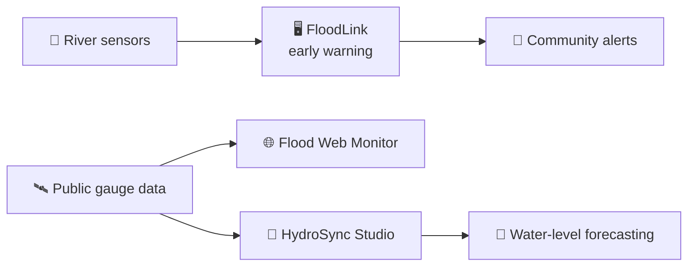

<!-- ─────────────── FloodLink 1.0 (private) ─────────────── -->

**🔒 FloodLink 1.0**: a low-cost flood early-warning system for riverside communities, and the project that won **2nd Place at Idea to Invention 2025**.

 

<!-- ─────────────── Flood Web Monitor (public) ─────────────── -->
<a href="https://olithainduvara.github.io/Peradeniya-And-Nawalapitiya-Water-Level-and-Rainfall_WebMonitor-Mahaweli-River-/"></a>

**Flood Web Monitor**: a real-time water-level and rainfall dashboard for the Peradeniya and Nawalapitiya gauges.

- Pulls the last 3 days of readings from a public **ArcGIS REST** feed and refreshes itself every 5 minutes.
- Plots both stations against the official flood thresholds and **raises an alert banner** when one is crossed.
- Offers CSV export per station or combined. All times are shown in Sri Lanka time.
- The whole app is a single `index.html` with **no dependencies and no build step**, deployed on GitHub Pages.

 

<!-- ─────────────── HydroSync Studio (public) ─────────────── -->
<a href="https://github.com/olithainduvara/HydroSync-1.0"></a>

**HydroSync Studio** (FloodLink 2.0): a desktop app that turns messy, overlapping gauge downloads into one clean training dataset.

- Merges rolling **72-hour exports** into a single row per hour per station. On the current data it removed **481 duplicate readings**.
- Handles **three timestamp formats**, one of them in UTC (verified against 68 overlapping hours), and converts them all to Sri Lanka time.
- Detects recording gaps so that no rows are invented across them, and fills only short dropouts.
- Has a **PySide6** interface with dark and light themes, drag-and-drop import and a headless CLI, and ships as a standalone **Windows .exe**.

 

<!-- ─────────────── Water Level Forecasting (private) ─────────────── -->

**🔒 Peradeniya Water Level Forecasting**: predicts the river level at Peradeniya hours ahead, using the gauge further upstream.

 

### ✈️ FlyMe: RC Aircraft Telemetry & Ground Station

<!-- ─────────────── FlyMe Hardware (private) ─────────────── -->

**🔒 FlyMe Hardware**: the flight telemetry hardware and firmware for an RC aircraft and its ground receiver.

 

<!-- ─────────────── FlyMe App (private) ─────────────── -->

**🔒 FlyMe Ground Station**: an Android app that tracks the aircraft live on a map, with alerts and flight replay.

 

### 🔬 More Engineering Projects

<!-- ─────────────── EMG Recorder (public) ─────────────── -->
<a href="https://github.com/olithainduvara/EMG-Data-Recorder-Via-NiDAQ-card"></a>

**EMG Recorder**: a desktop tool for recording muscle signals through the NI USB-6009 data acquisition card.

- Acquires, plots and records **three EMG channels** at the same time, paired with a hand-soldered instrumentation-amplifier front end.
- A configurable **notch filter** removes mains interference.
- Smooth under load, with a **worst-case UI stall of 49 ms**, and dark and light themes.
- Packaged as a **standalone Windows executable** that needs no Python installation.

 

<!-- ─────────────── Sobel Filter on FPGA (private) ─────────────── -->

**🔒 Sobel Filter on FPGA**: real-time image edge detection built in digital hardware and shown live on a monitor.

 

<!-- ─────────────── Drone Video Bridge (private) ─────────────── -->

**🔒 Drone Video Bridge**: sends a drone's live camera view to an HDMI screen for broadcasting, while the pilot keeps flying as normal.

 

<!-- ─────────────── MicroMouse (private) ─────────────── -->

**🔒 MicroMouse**: an autonomous robot that explores and solves a maze on its own. *In progress.*

---

  

