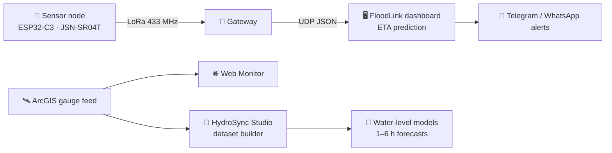
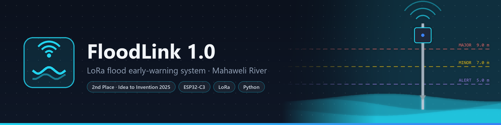
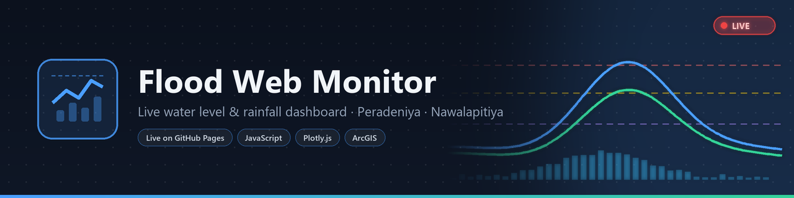
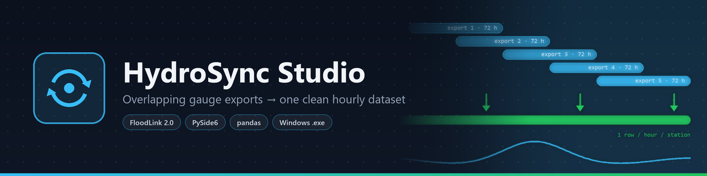
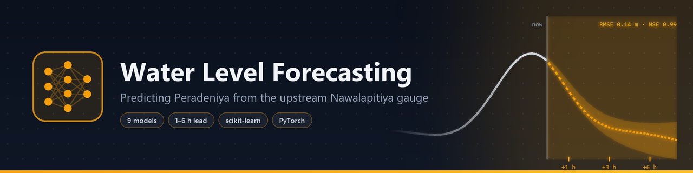
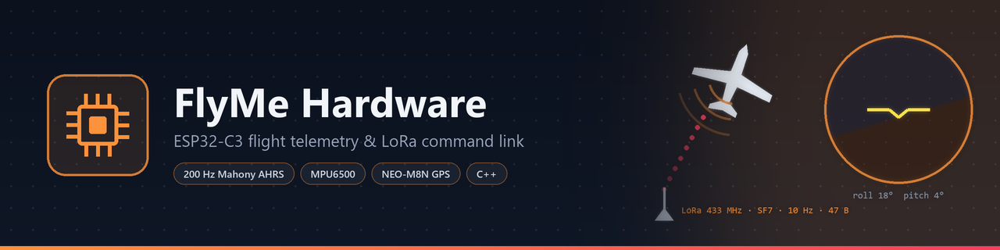
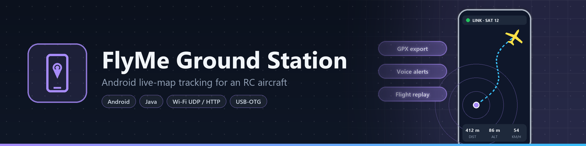
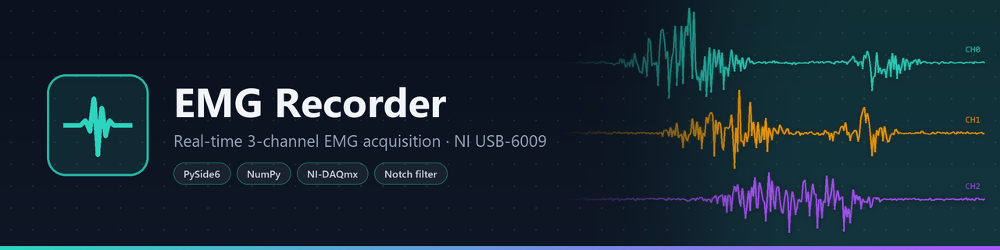
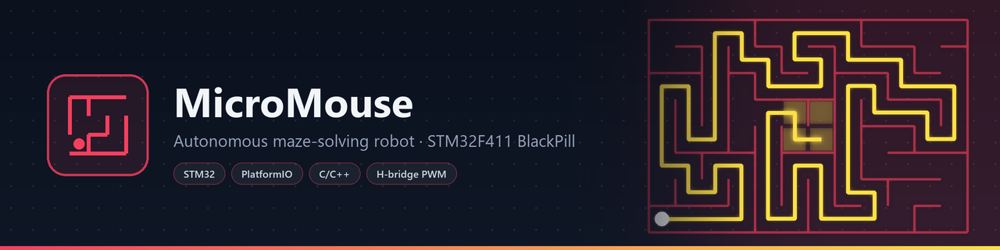

<!-- ═══════════════════════════════ HEADER ═══════════════════════════════ -->

  

---

## 👋 About Me

<table>
<tr>
<td width="32%" valign="top" align="center">

</td>
<td width="68%" valign="top">

I'm a third-year **Electrical & Electronic Engineering** undergraduate at the **University of Peradeniya, Sri Lanka**.

I build systems **end to end**: I solder the sensor node, write the firmware, design the radio link, and ship the desktop, web or mobile software that turns the data into decisions.

 

| | |
|:--|:--|
| 🌊 **Now building** | **FloodLink**, a LoRa flood early-warning system for the Mahaweli River |
| ✈️ **Also building** | **FlyMe**, ESP32 LoRa telemetry and an Android ground station for an RC aircraft |
| 🧠 **Exploring** | River-level forecasting with classical ML and neural networks |
| 🏆 **Recognition** | 2nd Place, *Idea to Invention 2025* |
| 🎥 **Beyond code** | EngEx 2025 Media Lead · DJI drone pilot · photographer · astronomy enthusiast |
| 🤝 **Community** | IEEE PES & IEEE MTT-S · Former President, Buddhist Society (FoE) |

</td>
</tr>
</table>

---

## 🧭 What I Work On

<table>
<tr>
<td width="33%" valign="top">

### 🔌 Embedded & IoT
ESP32-C3 and STM32 firmware, LoRa (SX1278) radio links, IMU sensor fusion, GPS, ultrasonic level sensing, custom binary packet protocols and hand-built hardware.

</td>
<td width="33%" valign="top">

### 📊 Data & Modelling
Time-series cleaning and merging, lead-lag analysis, regression, tree ensembles, MLPs and LSTMs, with leak-free cross-validation for hydrological forecasting.

</td>
<td width="33%" valign="top">

### 🖥️ Apps & Dashboards
PySide6 desktop apps packaged as standalone `.exe`s, zero-dependency web dashboards, and an Android ground station over Wi-Fi/UDP and USB-OTG.

</td>
</tr>
</table>

---

## 🚀 Featured Projects

> Projects marked 🔒 are in private repositories. This page gives an overview of each one.

### 🌊 FloodLink: Flood Early-Warning Ecosystem

Several projects that together cover the full pipeline from river sensor to community alert on the Mahaweli River, Sri Lanka:

<!-- ─────────────── FloodLink 1.0 ─────────────── -->

**🔒 FloodLink 1.0**: a low-cost flood early-warning prototype, and the project that won **2nd Place at Idea to Invention 2025**.

- Hand-soldered **ESP32-C3 + JSN-SR04T** ultrasonic sensor nodes send river levels over **SX1278 LoRa** to a central gateway.
- A live dashboard receives UDP telemetry and fits a regression model to estimate **when each flood threshold (Alert, Minor, Major) will be crossed**.
- A local NDJSON event bus feeds **Telegram** and **WhatsApp (Twilio)** dispatchers that send alerts to the community.
- A Streamlit simulation dashboard is included for demos and testing.

 

<!-- ─────────────── Flood Web Monitor ─────────────── -->

**Flood Web Monitor**: a real-time water-level and rainfall dashboard for the Peradeniya and Nawalapitiya gauges.

- Pulls the last 3 days of readings from a public **ArcGIS REST** feed and refreshes itself every 5 minutes.
- Plots both stations against the official flood thresholds and **raises an alert banner** when one is crossed.
- Offers CSV export per station or combined. All times are shown in Sri Lanka time.
- The whole app is a single `index.html` with **no dependencies and no build step**, deployed on GitHub Pages.

 

<!-- ─────────────── HydroSync Studio ─────────────── -->

**🔒 HydroSync Studio** (FloodLink 2.0): a desktop app that turns messy, overlapping gauge downloads into one clean training dataset.

- Merges rolling **72-hour exports** into a single row per hour per station. On the current data it removed **481 duplicate readings**.
- Handles **three timestamp formats**, one of them in UTC (verified against 68 overlapping hours), and converts them all to Sri Lanka time.
- Detects recording gaps so that no rows are invented across them, and fills only short dropouts.
- Has a **PySide6** interface with dark and light themes, drag-and-drop import and a headless CLI, and ships as a standalone **Windows .exe**.

 

<!-- ─────────────── Water Level Forecasting ─────────────── -->

**🔒 Peradeniya Water Level Forecasting**: forecasts the Peradeniya gauge from the upstream Nawalapitiya gauge and rainfall at both stations.

- Lead-lag analysis shows that Nawalapitiya **leads Peradeniya by 3–4 hours**, and that delay is what makes forecasting possible.
- Compares **9 models** (Ridge, Random Forest, Extra Trees, Gradient Boosting, SVR, MLP, LSTM and baselines) at **0, 1, 3 and 6 h lead times**.
- Uses leave-one-part-out cross-validation, so no feature is ever computed across the 39-day gap in the data.
- **Best result: 0.14 m RMSE with NSE 0.99 at 1 hour ahead**, a 45% improvement over the persistence baseline.

 

### ✈️ FlyMe: RC Aircraft Telemetry & Ground Station

<!-- ─────────────── FlyMe Hardware ─────────────── -->

**🔒 FlyMe Hardware**: ESP32-C3 firmware for the aircraft and its ground receiver.

- **200 Hz Mahony attitude estimation** on an MPU6500 IMU, plus NEO-M8N GPS for position and ground speed.
- A packed **47-byte telemetry frame sent 10 times per second** over LoRa (433 MHz, SF7), transmitted asynchronously so the 200 Hz filter never blocks.
- An acknowledged command uplink carries ground commands such as sensor calibration. Each command is repeated until the aircraft echoes its ID.
- The ground receiver bridges LoRa to **USB serial, Wi-Fi UDP and HTTP** using a documented JSON link protocol.

 

<!-- ─────────────── FlyMe App ─────────────── -->

**🔒 FlyMe Ground Station**: an Android app for tracking the aircraft live.

- Shows the aircraft on satellite, dark or street maps, with distance from home, altitude, speed, heading, range rings and a return-to-home arrow.
- A full-screen HUD shows link and LoRa signal, satellites, battery and a flight timer.
- **Voice and vibration alerts** for signal loss, GPS fix loss, maximum distance, low altitude and low battery.
- Records flights automatically, with replay and **GPX export**. Connects over Wi-Fi (UDP/HTTP) or a **USB-OTG** cable, and has a built-in demo flight.

 

### 🔬 More Engineering Projects

<!-- ─────────────── EMG Recorder ─────────────── -->

**EMG Recorder**: a desktop tool for recording muscle signals through the NI USB-6009 data acquisition card.

- Acquires, plots and records **three EMG channels** at the same time, paired with a hand-soldered instrumentation-amplifier front end.
- A configurable **notch filter** removes mains interference.
- Smooth under load, with a **worst-case UI stall of 49 ms**, and dark and light themes.
- Packaged as a **standalone Windows executable** that needs no Python installation.

 

<!-- ─────────────── MicroMouse ─────────────── -->

**🔒 MicroMouse**: an autonomous maze-solving robot built on the **STM32F411 BlackPill**.

- Dual-motor PWM speed and direction control through an H-bridge driver.
- Built with PlatformIO (Arduino framework), plus STM32Cube HAL projects for low-level peripheral work.
- *In progress:* wall sensing and maze-solving algorithms.

---

## 🛠️ Tech Stack

**Languages**

**Hardware & Embedded**

**Data, ML & Apps**

**Tools**

---

## 🏆 Highlights

| | |
|:--|:--|
| 🥈 | **2nd Place, Idea to Invention 2025** with FloodLink |
| 🎬 | **Media Lead, EngEx 2025**, Sri Lanka's largest engineering exhibition |
| 🔭 | **International Asteroid Search Campaign**, citizen-science asteroid hunting |
| 🎤 | Invited speaker on *AI, Technology & Future Robotics* for the Lions Club of Puttalam |
| 🚁 | Aerial cinematography for the university's **first-ever drone show** |

---

## 📈 GitHub Stats

---

  

